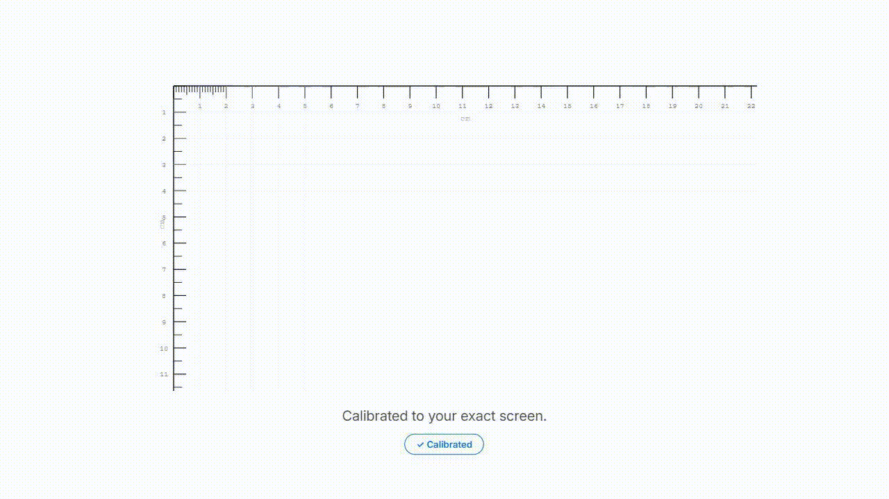
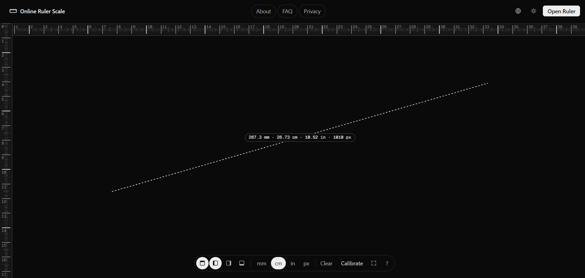
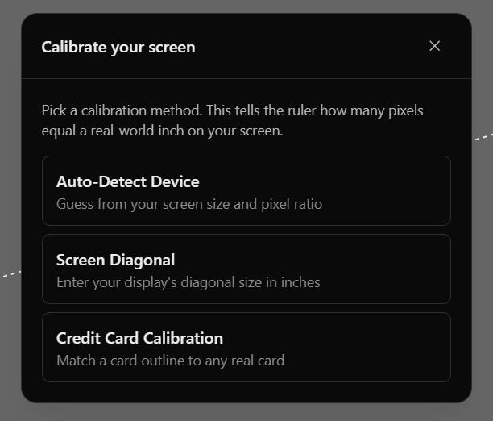
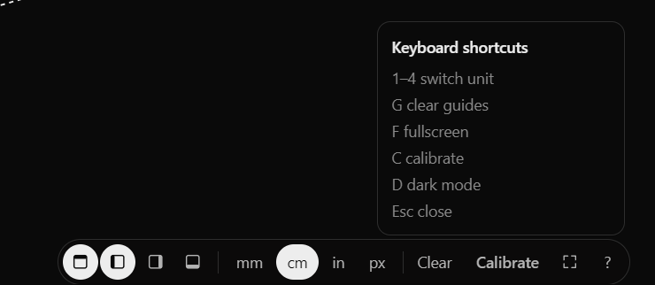
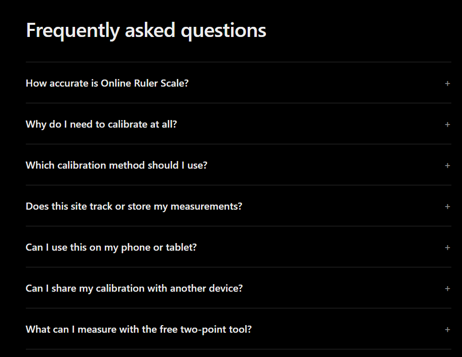

# 📏 Online Ruler Scale

<p align="center">
  <strong>A free, privacy-first, on-screen ruler that measures in real physical units.</strong><br />
  Calibrates to your exact display density instead of guessing at a fixed 96 DPI.
</p>

<p align="center">
  <a href="https://onlinerulerscale.netlify.app/"></a>
  
  
  
  
</p>

---

<p align="center">
  
</p>

---

## 💡 Why Online Ruler Scale?

Most "online rulers" on the web render tick marks assuming a standard **96 CSS pixels per inch (PPI)**. On high-resolution laptops, external monitors, retina screens, or mobile displays, this assumption is completely wrong — causing measurements to be off by **20% to 50% or more**.

**Online Ruler Scale** fixes this by calibrating your browser to your screen's actual physical hardware dimensions. Once calibrated, a centimeter on your screen is an actual, physical centimeter in the real world.

---

## 📸 Screenshots

<table>
  <tr>
    <td width="50%" align="center">
      
      <br />
      <strong>1. Interactive Two-Point Measurement</strong><br />
      <sub>Free drag-to-measure across screen with live multi-unit readout</sub>
    </td>
    <td width="50%" align="center">
      
      <br />
      <strong>2. Three Screen Calibration Methods</strong><br />
      <sub>Auto-detect, screen diagonal, & physical card alignment</sub>
    </td>
  </tr>
  <tr>
    <td width="50%" align="center">
      
      <br />
      <strong>3. Floating Toolbar & Shortcuts</strong><br />
      <sub>Quick unit switching, guide controls, & keyboard navigation</sub>
    </td>
    <td width="50%" align="center">
      
      <br />
      <strong>4. FAQ & Documentation</strong><br />
      <sub>Comprehensive guide covering accuracy, units, and privacy</sub>
    </td>
  </tr>
</table>

---

## ✨ Key Features

- 🎯 **Pixel-Accurate Physical Calibration**: Three independent calibration flows guarantee real-world measurement fidelity across any display.
- 📐 **Dual Measurement Modes**:
  - **Fixed Edge Rulers**: Top (horizontal) and Left (vertical) scales with millimeter, centimeter, and inch increments.
  - **Free Two-Point Drag Tool**: Click and drag across the canvas to measure arbitrary angles and distances with dynamic guide markers.
- 🔄 **Multi-Unit Live Readouts**: Instant conversion between Millimeters (`mm`), Centimeters (`cm`), Inches (`in`), and Pixels (`px`).
- 🌐 **Multilingual (i18n)**: Native internationalization with English (`en`), Spanish (`es`), Portuguese (`pt`), and Russian (`ru`).
- 🌓 **Dark & Light Modes**: Minimalist, Vercel/Geist-inspired aesthetic designed for clarity with zero visual clutter.
- 🖥️ **Fullscreen Immersion**: Press <kbd>F</kbd> for edge-to-edge measurement without browser chrome interference.
- 🔗 **Shareable Calibrations**: Generate portable calibration URLs to share exact display configurations with team members or other devices.
- 🔒 **100% Client-Side & Privacy-First**: No cookies, no tracking scripts, no account required. Measurement data never leaves your device.

---

## ⌨️ Keyboard Shortcuts

| Key | Action |
|:---:|:---|
| <kbd>1</kbd> | Switch unit to **Millimeters (mm)** |
| <kbd>2</kbd> | Switch unit to **Centimeters (cm)** |
| <kbd>3</kbd> | Switch unit to **Inches (in)** |
| <kbd>4</kbd> | Switch unit to **Pixels (px)** |
| <kbd>G</kbd> | Clear measurement guides and lines |
| <kbd>F</kbd> | Toggle **Fullscreen mode** |
| <kbd>C</kbd> | Open **Calibration modal** |
| <kbd>D</kbd> | Toggle **Dark / Light theme** |
| <kbd>Esc</kbd> | Close modal / Cancel active measurement |

---

## 🛠️ Tech Stack

- **Framework**: [Astro](https://astro.build/) (Static Site Generation)
- **Styling**: [Tailwind CSS v4](https://tailwindcss.com/)
- **Typography**: [Geist Sans & Geist Mono](https://vercel.com/font) via `@fontsource`
- **Language**: [TypeScript](https://www.typescriptlang.org/)
- **SEO & Performance**: `@astrojs/sitemap`, zero runtime client framework overhead
- **Deployment**: [Netlify](https://www.netlify.com/)

---

## 📁 Project Structure

```text
Online_Ruler_Scale/
├── public/                 # Static assets, web manifests, icons
├── screenshots/            # Showcase media (brag.gif, ss1.png - ss4.png)
├── src/
│   ├── components/
│   │   ├── marketing/      # Feature cards, FAQ accordions
│   │   ├── ruler/          # RulerApp canvas & interactive UI
│   │   └── site/           # Nav, Footer, ThemeToggle, LanguagePicker
│   ├── layouts/            # BaseLayout & PageLayout wrappers
│   ├── lib/
│   │   ├── i18n.ts         # Internationalization dictionary & locale state
│   │   ├── theme.ts        # Dark/light theme management
│   │   └── ruler/          # Measurement engine & calibration logic
│   │       ├── calibration/ # Auto-detect, screen diagonal, credit card math
│   │       ├── measure.ts  # Two-point drag calculations
│   │       ├── render.ts   # Canvas & SVG tick mark rendering
│   │       ├── state.ts    # Reactive measurement state
│   │       └── units.ts    # DPI, PPI, and metric/imperial conversions
│   ├── pages/              # Astro pages (index, about, faq, privacy)
│   └── styles/
│       └── global.css      # Tailwind 4 configuration & custom styling
├── astro.config.mjs        # Astro configuration & sitemap integration
├── package.json            # Dependencies & npm scripts
└── README.md               # Project documentation
```

---

## 🚀 Getting Started

### Prerequisites

- [Node.js](https://nodejs.org/) `>= 20.0.0`
- [npm](https://www.npmjs.com/) (or `pnpm` / `yarn`)

### Installation

1. **Clone the repository:**
   ```bash
   git clone https://github.com/your-username/online-ruler-scale.git
   cd online-ruler-scale
   ```

2. **Install dependencies:**
   ```bash
   npm install
   ```

3. **Start the local development server:**
   ```bash
   npm run dev
   ```
   Open [http://localhost:4321](http://localhost:4321) in your browser.

4. **Build for production:**
   ```bash
   npm run build
   ```

5. **Preview production build:**
   ```bash
   npm run preview
   ```

---

## 📄 License

This project is open source and available under the [MIT License](LICENSE).
